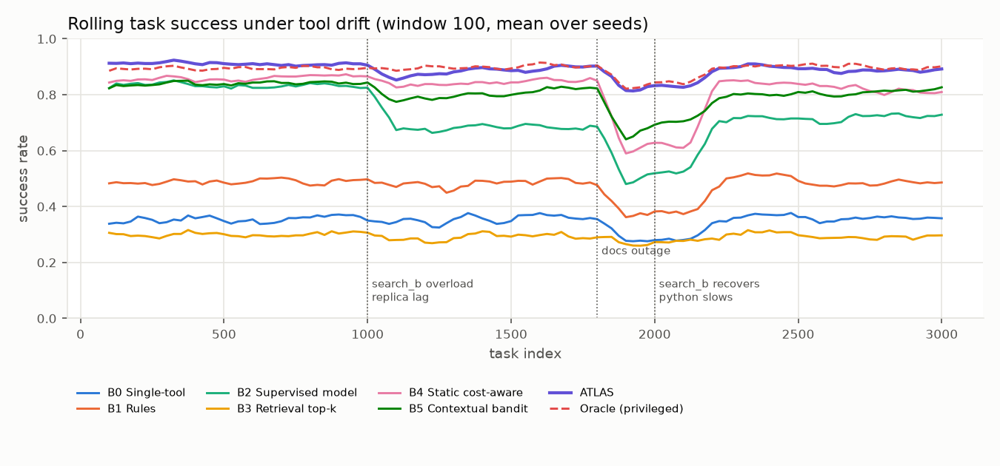

# ATLAS — Adaptive Tool Learning and Allocation System

**Research question.** Can an agent choose the smallest, cheapest, most reliable *set* of tools that is sufficient
to answer a query, and keep making good choices as tool latency, failure rates and quality drift?

ATLAS is a tool router for LLM agents, with LangChain/LangGraph integration included. For each query it picks the
**cheapest plan that meets explicit quality, reliability and latency-tail constraints**. It learns how each tool behaves
while running, and after execution it decides whether **one more call is worth its cost**.

* **Algorithm:** AND–OR plan search over typed tool capabilities, combined with constrained, time-decayed Thompson
  sampling. Also fallback replanning, a value-of-information stopping rule, and a correction for censored feedback.
  → [research/algorithm_design.md](research/algorithm_design.md)
* **Evidence:**
  * A simulator study: 6 baselines plus a privileged oracle, 10 ablations, drift, scaling and SLO sweeps, 20 seeds.
  * A **live evaluation on tools that really execute**, over 10 seeds.
  * An understanding-stage study that includes a local LLM.
  * Common random numbers, bootstrap CIs and Holm-corrected paired tests throughout.
  → [RESULTS.md](benchmarks/reports/RESULTS.md), [LIVE.md](benchmarks/reports/LIVE.md), [E6](benchmarks/reports/E6_understanding.md)
* **Production:** a FastAPI service with RBAC, an audit log, Prometheus metrics, a feedback loop, and state snapshots
  (file or Redis). Also hardened SQL and Python tools, Docker Compose and CI. → [docs/](docs/)

**Cost** throughout is a *simulated* per-call tool price, for example calculator $0.0001, replica SQL $0.0005, web
search $0.002–0.008. It is summed over the calls a router makes and divided by the number of correctly answered tasks,
and reported in milli-USD (1 m$ = $0.001). No paid APIs are used anywhere in this project, and no money is spent
running it.

## 1. Simulator results (20 seeds, held-out query phrasings)

Each cell is the mean, with the 95% bootstrap CI over seeds for success.

| Router | E1 stationary: success | E1: cost / success | E2 drift: success | E2: cost / success |
|---|---|---|---|---|
| B0 Single tool per category | 0.354 [0.349, 0.359] | 6.34 | 0.348 [0.344, 0.352] | 6.41 |
| B1 Rules (keyword, permission-aware) | 0.486 [0.480, 0.492] | 6.12 | 0.475 [0.471, 0.479] | 6.26 |
| B2 Model-based (supervised on oracle plans) | 0.833 [0.830, 0.837] | **3.97** | 0.724 [0.720, 0.729] | **4.54** |
| B3 Retrieval (BM25 + vector, top-2) | 0.296 [0.292, 0.300] | 11.57 | 0.293 [0.289, 0.297] | 11.69 |
| B4 Static cost-aware (same planner, frozen stats) | 0.863 [0.856, 0.869] | 4.91 | 0.820 [0.809, 0.829] | 4.99 |
| B5 Contextual bandit (scalarised reward) | 0.838 [0.835, 0.842] | 4.24 | 0.803 [0.799, 0.806] | **4.54** |
| **ATLAS** | **0.907 [0.904, 0.909]** | 4.20 | **0.889 [0.888, 0.891]** | 4.59 |
| Oracle (true requirements + true current params) | 0.894 [0.892, 0.897] | 3.28 | 0.891 [0.889, 0.893] | 3.71 |

**Success.** ATLAS has the highest success of every non-oracle router in both settings. Every success difference is
significant after Holm correction (p ≤ 0.0011, n = 20 paired seeds).

**Cost per success.** ATLAS is cheaper than the rules (B1), static (B4), single-tool and retrieval routers. Against the
supervised router (B2) it is **more expensive in E1** (+0.23 m$, significant) and **tied under drift** (+0.05, n.s.). It
is also tied with the contextual bandit (B5). That is the price of the default quality target, Q_min = 0.8.

**Operating points.** [E5](benchmarks/reports/RESULTS.md#e5--slo--value-of-success-sweep-under-drift) maps the
trade-off. With Q_min = 0.7, ATLAS gets **0.865 success at 4.05 m$** under drift; with Q_min = 0.6, **0.850 at 3.75
m$**. Both beat B2 (0.724 / 4.54), B4 and B5 on *both* axes. (E5 uses 10 seeds; these operating points were picked
after seeing the sweep.)



## 2. Live evaluation: real tools, real failures (10 seeds × 400 tasks)

Routers drive **real** tool executions: SQLite (a primary and a stale replica), hybrid and BM25 retrieval over policy
corpora, a log index and a full log scan, a calculator, and a subprocess Python sandbox. All run over a generated
company world, and answers are graded against ground truth. Network latency, transient errors and a drift schedule
are injected identically for every router:
* a primary-database incident;
* a noisy neighbour on the sandbox;
* a degraded search cluster.

Method: [docs/experiments.md](docs/experiments.md#live-evaluation-real-tool-execution).

| Router | Success | During DB incident | Cost / success (m$) | p95 latency (ms) |
|---|---|---|---|---|
| **ATLAS** | **0.902 [0.889, 0.916]** | **0.809** | 3.33 | 1243 |
| Rules, best-quality tools | 0.811 [0.784, 0.840] | 0.514 | 3.08 | 1269 |
| B4 Static cost-aware | 0.786 [0.752, 0.820] | 0.514 | 3.46 | 1223 |
| B5 Contextual bandit | 0.516 [0.501, 0.534] | 0.456 | 2.58 | 584 |
| Rules, cheapest tools | 0.484 [0.473, 0.494] | 0.469 | 1.14 | 74 |

ATLAS's success advantage over every baseline is significant after Holm correction (p = 0.02: ATLAS wins on all 10
seeds, and 0.02 is the smallest p a 10-seed Wilcoxon test can reach after correcting for 10 comparisons). Highlights:
* Against the best-quality rules it gains **+9.1 points for +0.25 m$ per success**. Its edge comes from routing around
  the database incident, by switching to the stale replica, which is right for most quarters.
* B5 scores 0% on calculation questions, because it cannot plan SQL → compute dependencies.

## 3. Does the advantage depend on query understanding? (E6)

| Understanding stage | Exact-set accuracy | ms / query | ATLAS | B5 | B4 |
|---|---|---|---|---|---|
| Oracle (true family) | 1.00 | — | **0.922** | 0.849 | 0.863 |
| TF-IDF classifier (default) | 0.90 | 3 | **0.902** | 0.819 | 0.831 |
| Oracle + 20% corruption | 0.85 | — | **0.806** | 0.730 | 0.748 |
| Oracle + 40% corruption | 0.60 | — | **0.661** | 0.585 | 0.610 |
| Local LLM: Qwen2.5-0.5B (llama.cpp, CPU) | 0.35 | 635 | **0.490** | 0.443 | 0.442 |

ATLAS leads at every understanding quality. A 0.5B local LLM is a much *worse* understanding stage than a small trained
classifier: lower accuracy, and about 200× slower. Understanding errors cap every router.

## 4. Hypotheses (see [research/hypotheses.md](research/hypotheses.md))

H1–H6 were fixed before the first reported run. H7b, H8 and H9 were registered after development on separate dev
seeds, before the 20-seed rerun.

| | Hypothesis | Outcome |
|---|---|---|
| H1 | Higher success than the rules router and the model-based router | **Supported.** +0.42 vs B1 and +0.07 vs B2 (stationary); +0.41 and +0.17 under drift; +0.09 vs rules on live tools |
| H2 | Lower cost per successful task than both | **Partly.** Supported vs B1 (−1.9 / −1.7 m$). **Not supported vs B2** at the default Q_min: +0.23 m$ stationary, +0.05 n.s. under drift. Supported at Q_min ≤ 0.7 (E5) |
| H3 | The gain is more than "using history": beats the static cost-aware router under drift | **Supported.** +0.070 success, −0.40 m$ vs B4 |
| H4 | Beats a contextual bandit without plan structure or constraints | **Supported for success** (+0.087). Cost per success is tied (+0.05, n.s.) |
| H5 | Plan-graph search and VoI stopping each contribute | **Supported.** Removing the plan graph costs −0.279 success. Removing VoI costs −0.073 success but is 0.32 m$ cheaper |
| H6 | Routing overhead stays at a few ms up to 500 tools | **Not supported.** Planning p95 at 512 tools is 15.5 ms (27 ms before relevance-restricted scoring). Success falls from 0.91 to 0.79 |
| H7b | Planning p95 ≤ 10 ms at 512 tools | **Not supported** (15.5 ms) |
| H8 | Imputing answers superseded by verification raises success | **Supported.** +0.015 vs A10 |
| H9 | …and raises cost per success | **Supported.** +0.38 m$ vs A10 (ATLAS stops relying on cheap tools plus verification) |

### What the results do *not* show (read before quoting numbers)

* **Cheapest per success at the default setting.** At the default setting B2 is cheaper in E1, and B2 and B5 tie it
  under drift. The rules router is cheaper on live tools. ATLAS buys its success with more expensive tools. E5 shows
  where it beats B2, B4 and B5 on both axes, but those operating points were chosen after the sweep.
* **Fewer calls.** ATLAS makes about 1.9 calls per task vs about 1.6 for B4/B5. It has 0.35–0.37 *strict* unnecessary
  calls per task vs about 0.12, because verification calls count as unnecessary by design.
* **Tail latency.** Under drift, ATLAS's p95 (1357 ms) is worse than B5's (1252 ms): 3.7% vs 3.1% of tasks exceed the
  budget.
* **Large registries.** With 500 near-duplicate tools, success drops to 0.79. Three remedies did not help on
  development seeds and were dropped (√N admission control, pooled priors, pessimistic constraints;
  [details](research/hypotheses.md)).
* **Component effects.** Learned reliability (A2) and learned latency (A6) have no measurable effect here. Per-family
  context (A1), cost-awareness (A3) and exploration (A9) each *lower* success by 0.7–1.2 points but save
  0.17–0.77 m$ per success.
* **External validity.** Simulator parameters are hand-specified. The live world is generated, and its latency and
  faults are injected; tool outputs and execution are real. None of this is a production traffic measurement.

## Quick start

```bash
python -m venv .venv && . .venv/bin/activate          # Windows: .venv\Scripts\activate
pip install -e ".[dev,langchain]"
pytest -q                                              # 64 tests: unit, property, integration, API, LangGraph

uvicorn atlas.api.app:app --port 8000                  # demo service (key: dev-key)
curl -s localhost:8000/v1/execute -H 'X-API-Key: dev-key' -H 'Content-Type: application/json' \
     -d '{"query": "Calculate the percentage change in revenue between Q1 and Q2"}'

docker compose up --build                              # API + Redis + Prometheus
```

## Reproducing every number

```bash
python -m benchmarks.experiments.run_all --workers 5   # E1–E5, seeds 1–20 (~31 min on 6 cores); resumable
python -m benchmarks.experiments.report                # benchmarks/reports/RESULTS.md + figures
python -m benchmarks.live.run --seeds 1-10 --tasks 400 # live evaluation (~15 min per seed, seeds run in parallel)
python -m benchmarks.experiments.understanding         # E6 (uses the committed LLM output cache)
```

Seeds 0, 101 and 102 were used for development and are excluded. The simulator uses common random numbers, so every
router sees identical tasks and identical per-(task, tool, attempt) outcomes.

## Using ATLAS in a LangChain agent

```python
from atlas.integrations.langchain import AtlasToolSelector, atlas_node

selector = AtlasToolSelector(
    [(my_tool, ToolSpec(name="my_tool", description="...", provides=frozenset({"web_facts"}), cost=0.004))], understanding
)
tools, decision = await selector.select(query)  # bind only these to the LLM: llm.bind_tools(tools)
await selector.feedback(decision.context.request_id, success=True)
graph.add_node("atlas", atlas_node(selector))  # or let ATLAS execute the plan inside LangGraph
```

## Repository map

| Path | Contents |
|---|---|
| [research/](research/) | Literature review and gap, formal problem, algorithm design, pre-registered hypotheses |
| [atlas/](atlas/) | Router, planner, estimators, executor, tools, API, persistence, LangChain integration, local-LLM understanding |
| [benchmarks/](benchmarks/) | Simulator and task families, baselines, harness, statistics, experiments, live evaluation, report |
| [tests/](tests/) | Unit, property-based (plan search vs brute force), integration, API and security tests |
| [docs/](docs/) | Architecture, API, deployment, experimental methodology |
| [deployment/](deployment/) | Dockerfile, Prometheus config |

## License

MIT
