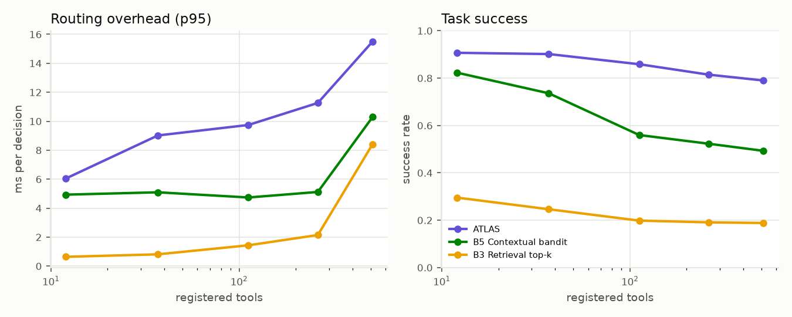
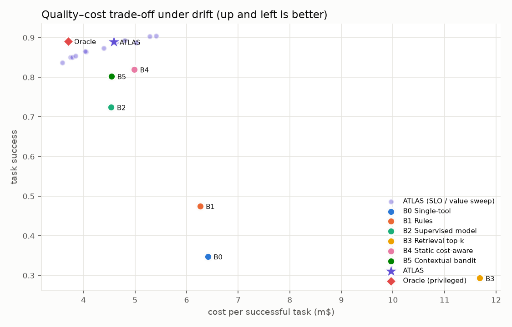

# ATLAS — experimental results

Generated by `python -m benchmarks.experiments.report`. Seeds: [1, 2, 3, 4, 5, 6, 7, 8, 9, 10, 11, 12, 13, 14, 15, 16, 17, 18, 19, 20].
Cells show the mean over seeds with a 95% bootstrap CI over seeds. Paired tests are Wilcoxon
signed-rank on per-seed values (common random numbers), Holm-corrected within each table;
d_z is the paired standardised mean difference.

## E1 — Stationary tools (2000 held-out-template tasks per seed)

| Router | Task success | Cost / success (m$) | Tool calls / task | Unnecessary calls / task | Latency p50 (ms) | Latency p95 (ms) | P(latency > budget) |
|---|---|---|---|---|---|---|---|
| B0 Single-tool | 0.354 [0.349, 0.359] | 6.34 [6.23, 6.45] | 0.73 [0.72, 0.73] | 0.029 [0.028, 0.030] | 111 [110, 112] | 407 [402, 412] | 0.005 [0.005, 0.006] |
| B1 Rules | 0.486 [0.480, 0.492] | 6.12 [6.02, 6.22] | 1.16 [1.15, 1.17] | 0.187 [0.181, 0.194] | 144 [142, 146] | 653 [647, 660] | 0.007 [0.007, 0.008] |
| B2 Supervised model | 0.833 [0.830, 0.837] | 3.97 [3.92, 4.03] | 1.52 [1.52, 1.53] | 0.115 [0.112, 0.119] | 176 [173, 179] | 677 [674, 681] | 0.012 [0.011, 0.013] |
| B3 Retrieval top-k | 0.296 [0.292, 0.300] | 11.57 [11.41, 11.72] | 1.89 [1.89, 1.89] | 1.257 [1.250, 1.264] | 128 [127, 129] | 588 [582, 594] | 0.016 [0.015, 0.017] |
| B4 Static cost-aware | 0.863 [0.856, 0.869] | 4.91 [4.70, 5.13] | 1.64 [1.62, 1.65] | 0.116 [0.113, 0.119] | 304 [284, 326] | 784 [773, 795] | 0.013 [0.012, 0.014] |
| B5 Contextual bandit | 0.838 [0.835, 0.842] | 4.24 [4.18, 4.31] | 1.58 [1.57, 1.59] | 0.115 [0.113, 0.118] | 209 [204, 214] | 754 [746, 764] | 0.012 [0.011, 0.013] |
| ATLAS | 0.907 [0.904, 0.909] | 4.20 [4.10, 4.30] | 1.86 [1.83, 1.88] | 0.348 [0.327, 0.369] | 255 [242, 268] | 922 [902, 941] | 0.015 [0.014, 0.017] |
| Oracle (privileged) | 0.894 [0.892, 0.897] | 3.28 [3.24, 3.32] | 1.50 [1.49, 1.51] | 0.000 [0.000, 0.000] | 156 [154, 158] | 655 [650, 659] | 0.011 [0.010, 0.013] |

### ATLAS vs baselines (E1)

| ATLAS vs | Metric | Δ (ref − other) [95% CI] | Holm p | d_z |
|---|---|---|---|---|
| B0 Single-tool | Task success | 0.553 [0.548, 0.557] | 0.0011 | 51.51 |
| B0 Single-tool | Cost / success (m$) | -2.14 [-2.26, -2.03] | 4.6e-05 | -7.85 |
| B0 Single-tool | Tool calls / task | 1.13 [1.10, 1.15] | 4.6e-05 | 18.73 |
| B0 Single-tool | Unnecessary calls / task | 0.318 [0.298, 0.340] | 4.6e-05 | 6.72 |
| B1 Rules | Task success | 0.421 [0.415, 0.427] | 0.0011 | 30.29 |
| B1 Rules | Cost / success (m$) | -1.92 [-2.00, -1.84] | 4.6e-05 | -10.08 |
| B1 Rules | Tool calls / task | 0.69 [0.67, 0.72] | 4.6e-05 | 12.11 |
| B1 Rules | Unnecessary calls / task | 0.160 [0.139, 0.182] | 4.6e-05 | 3.24 |
| B2 Supervised model | Task success | 0.074 [0.070, 0.077] | 0.0011 | 9.05 |
| B2 Supervised model | Cost / success (m$) | 0.23 [0.16, 0.29] | 5.3e-05 | 1.47 |
| B2 Supervised model | Tool calls / task | 0.33 [0.31, 0.36] | 4.6e-05 | 6.25 |
| B2 Supervised model | Unnecessary calls / task | 0.232 [0.212, 0.253] | 0.0011 | 4.86 |
| B3 Retrieval top-k | Task success | 0.611 [0.607, 0.615] | 0.0011 | 62.72 |
| B3 Retrieval top-k | Cost / success (m$) | -7.37 [-7.51, -7.23] | 4.6e-05 | -22.88 |
| B3 Retrieval top-k | Tool calls / task | -0.03 [-0.06, -0.00] | 0.1 | -0.50 |
| B3 Retrieval top-k | Unnecessary calls / task | -0.909 [-0.934, -0.884] | 4.6e-05 | -15.79 |
| B4 Static cost-aware | Task success | 0.044 [0.038, 0.051] | 0.0011 | 2.80 |
| B4 Static cost-aware | Cost / success (m$) | -0.71 [-0.90, -0.53] | 0.00012 | -1.64 |
| B4 Static cost-aware | Tool calls / task | 0.22 [0.19, 0.24] | 4.6e-05 | 3.93 |
| B4 Static cost-aware | Unnecessary calls / task | 0.232 [0.212, 0.253] | 0.0011 | 4.86 |
| B5 Contextual bandit | Task success | 0.069 [0.065, 0.072] | 0.0011 | 8.38 |
| B5 Contextual bandit | Cost / success (m$) | -0.04 [-0.12, 0.03] | 0.29 | -0.25 |
| B5 Contextual bandit | Tool calls / task | 0.28 [0.25, 0.30] | 0.0011 | 4.97 |
| B5 Contextual bandit | Unnecessary calls / task | 0.232 [0.212, 0.254] | 0.0011 | 4.85 |

## E2 — Non-stationary tools (3000 tasks, drift at t=1000/1800/2000/2200)

| Router | Task success | Cost / success (m$) | Tool calls / task | Unnecessary calls / task | Latency p50 (ms) | Latency p95 (ms) | P(latency > budget) |
|---|---|---|---|---|---|---|---|
| B0 Single-tool | 0.348 [0.344, 0.352] | 6.41 [6.31, 6.51] | 0.72 [0.71, 0.72] | 0.028 [0.027, 0.029] | 108 [107, 109] | 382 [378, 387] | 0.007 [0.007, 0.008] |
| B1 Rules | 0.475 [0.471, 0.479] | 6.26 [6.17, 6.35] | 1.16 [1.15, 1.17] | 0.192 [0.187, 0.197] | 138 [137, 140] | 962 [938, 985] | 0.019 [0.018, 0.021] |
| B2 Supervised model | 0.724 [0.720, 0.729] | 4.54 [4.48, 4.60] | 1.50 [1.49, 1.50] | 0.113 [0.110, 0.116] | 213 [211, 216] | 1480 [1460, 1501] | 0.049 [0.047, 0.050] |
| B3 Retrieval top-k | 0.293 [0.289, 0.297] | 11.69 [11.53, 11.84] | 1.89 [1.89, 1.90] | 1.251 [1.246, 1.257] | 168 [167, 170] | 629 [623, 634] | 0.022 [0.021, 0.023] |
| B4 Static cost-aware | 0.820 [0.809, 0.829] | 4.99 [4.80, 5.18] | 1.60 [1.59, 1.61] | 0.115 [0.113, 0.118] | 281 [259, 305] | 1439 [1398, 1477] | 0.045 [0.041, 0.048] |
| B5 Contextual bandit | 0.803 [0.799, 0.806] | 4.54 [4.48, 4.61] | 1.57 [1.56, 1.58] | 0.115 [0.112, 0.118] | 216 [212, 220] | 1252 [1230, 1274] | 0.031 [0.030, 0.033] |
| ATLAS | 0.889 [0.888, 0.891] | 4.59 [4.50, 4.66] | 1.88 [1.86, 1.90] | 0.371 [0.354, 0.387] | 274 [264, 284] | 1357 [1340, 1374] | 0.037 [0.035, 0.038] |
| Oracle (privileged) | 0.891 [0.889, 0.893] | 3.71 [3.67, 3.74] | 1.50 [1.49, 1.50] | 0.000 [0.000, 0.000] | 159 [157, 160] | 1104 [1084, 1123] | 0.023 [0.022, 0.024] |

### Adaptation (E2)

| Router | Success t<1000 | Success 1000-2000 | Success 2000-3000 | Degraded-tool share (during) | Same tool share (after recovery) | Tasks to recover |
|---|---|---|---|---|---|---|
| B0 Single-tool | 0.354 [0.349, 0.359] | 0.340 [0.334, 0.346] | 0.350 [0.343, 0.356] | 0.000 [0.000, 0.000] | 0.000 [0.000, 0.000] | 362 [302, 423] |
| B1 Rules | 0.489 [0.481, 0.498] | 0.460 [0.453, 0.466] | 0.476 [0.469, 0.482] | 0.000 [0.000, 0.000] | 0.000 [0.000, 0.000] | 399 [340, 462] |
| B2 Supervised model | 0.832 [0.828, 0.836] | 0.646 [0.637, 0.655] | 0.695 [0.687, 0.703] | 0.092 [0.086, 0.098] | 0.094 [0.090, 0.098] | 1412 [1155, 1655] |
| B3 Retrieval top-k | 0.301 [0.296, 0.306] | 0.286 [0.279, 0.293] | 0.292 [0.285, 0.299] | 0.045 [0.043, 0.048] | 0.045 [0.041, 0.048] | 348 [280, 424] |
| B4 Static cost-aware | 0.859 [0.850, 0.866] | 0.796 [0.781, 0.810] | 0.804 [0.791, 0.815] | 0.050 [0.027, 0.074] | 0.063 [0.038, 0.089] | 371 [314, 430] |
| B5 Contextual bandit | 0.839 [0.833, 0.844] | 0.775 [0.769, 0.782] | 0.793 [0.787, 0.800] | 0.026 [0.022, 0.029] | 0.051 [0.044, 0.058] | 423 [312, 559] |
| ATLAS | 0.910 [0.907, 0.913] | 0.873 [0.869, 0.877] | 0.884 [0.881, 0.887] | 0.017 [0.014, 0.021] | 0.078 [0.067, 0.090] | 337 [273, 410] |
| Oracle (privileged) | 0.894 [0.890, 0.898] | 0.886 [0.882, 0.890] | 0.894 [0.888, 0.899] | 0.000 [0.000, 0.000] | 0.089 [0.085, 0.092] | 303 [244, 362] |

### ATLAS vs baselines (E2)

| ATLAS vs | Metric | Δ (ref − other) [95% CI] | Holm p | d_z |
|---|---|---|---|---|
| B0 Single-tool | Task success | 0.541 [0.537, 0.545] | 0.00097 | 56.56 |
| B0 Single-tool | Cost / success (m$) | -1.82 [-1.93, -1.72] | 4.6e-05 | -7.48 |
| B0 Single-tool | Tool calls / task | 1.16 [1.14, 1.18] | 4.6e-05 | 25.03 |
| B0 Single-tool | Unnecessary calls / task | 0.342 [0.326, 0.358] | 0.00097 | 9.13 |
| B1 Rules | Task success | 0.414 [0.410, 0.419] | 4.6e-05 | 40.11 |
| B1 Rules | Cost / success (m$) | -1.67 [-1.75, -1.59] | 4.6e-05 | -9.12 |
| B1 Rules | Tool calls / task | 0.72 [0.70, 0.74] | 4.6e-05 | 17.04 |
| B1 Rules | Unnecessary calls / task | 0.179 [0.162, 0.194] | 4.6e-05 | 4.84 |
| B2 Supervised model | Task success | 0.165 [0.160, 0.169] | 0.00097 | 16.10 |
| B2 Supervised model | Cost / success (m$) | 0.05 [-0.00, 0.10] | 0.23 | 0.43 |
| B2 Supervised model | Tool calls / task | 0.38 [0.36, 0.40] | 4.6e-05 | 9.61 |
| B2 Supervised model | Unnecessary calls / task | 0.257 [0.242, 0.273] | 4.6e-05 | 7.32 |
| B3 Retrieval top-k | Task success | 0.596 [0.592, 0.600] | 0.00097 | 70.85 |
| B3 Retrieval top-k | Cost / success (m$) | -7.10 [-7.24, -6.94] | 4.6e-05 | -20.11 |
| B3 Retrieval top-k | Tool calls / task | -0.01 [-0.04, 0.01] | 0.27 | -0.29 |
| B3 Retrieval top-k | Unnecessary calls / task | -0.881 [-0.899, -0.862] | 4.6e-05 | -20.64 |
| B4 Static cost-aware | Task success | 0.070 [0.060, 0.080] | 4.6e-05 | 3.08 |
| B4 Static cost-aware | Cost / success (m$) | -0.40 [-0.58, -0.21] | 0.0068 | -0.90 |
| B4 Static cost-aware | Tool calls / task | 0.27 [0.26, 0.29] | 0.00097 | 6.91 |
| B4 Static cost-aware | Unnecessary calls / task | 0.255 [0.239, 0.271] | 4.6e-05 | 6.91 |
| B5 Contextual bandit | Task success | 0.087 [0.084, 0.090] | 0.00097 | 12.61 |
| B5 Contextual bandit | Cost / success (m$) | 0.05 [-0.02, 0.10] | 0.27 | 0.31 |
| B5 Contextual bandit | Tool calls / task | 0.31 [0.29, 0.32] | 0.00097 | 7.85 |
| B5 Contextual bandit | Unnecessary calls / task | 0.256 [0.240, 0.272] | 4.6e-05 | 6.93 |

## E3 — Ablations under drift

| Router | Task success | Cost / success (m$) | Tool calls / task | Unnecessary calls / task | Latency p50 (ms) | Latency p95 (ms) |
|---|---|---|---|---|---|---|
| ATLAS | 0.889 [0.888, 0.891] | 4.59 [4.50, 4.66] | 1.88 [1.86, 1.90] | 0.371 [0.354, 0.387] | 274 [264, 284] | 1357 [1340, 1374] |
| A1 -context | 0.899 [0.897, 0.901] | 5.23 [5.12, 5.33] | 1.89 [1.87, 1.91] | 0.336 [0.319, 0.355] | 370 [352, 387] | 1406 [1390, 1423] |
| A2 -reliability | 0.888 [0.887, 0.890] | 4.54 [4.46, 4.61] | 1.89 [1.87, 1.91] | 0.380 [0.364, 0.396] | 278 [265, 290] | 1390 [1379, 1401] |
| A3 -cost | 0.901 [0.899, 0.903] | 5.36 [5.28, 5.44] | 1.82 [1.80, 1.85] | 0.302 [0.280, 0.326] | 333 [320, 346] | 1339 [1323, 1353] |
| A4 -plan graph | 0.610 [0.606, 0.615] | 6.41 [6.32, 6.52] | 1.39 [1.37, 1.40] | 0.252 [0.241, 0.261] | 185 [182, 188] | 897 [881, 913] |
| A5 -VoI stopping | 0.816 [0.814, 0.818] | 4.27 [4.19, 4.36] | 1.61 [1.60, 1.62] | 0.116 [0.113, 0.119] | 204 [199, 209] | 1208 [1189, 1227] |
| A6 -latency | 0.889 [0.887, 0.891] | 4.68 [4.59, 4.76] | 1.89 [1.87, 1.91] | 0.384 [0.368, 0.399] | 267 [257, 277] | 1446 [1432, 1461] |
| A7 -feasibility | 0.875 [0.872, 0.878] | 4.50 [4.42, 4.56] | 1.87 [1.85, 1.89] | 0.379 [0.363, 0.396] | 275 [267, 283] | 1359 [1346, 1369] |
| A8 -fallback | 0.884 [0.883, 0.886] | 4.60 [4.50, 4.69] | 1.87 [1.85, 1.89] | 0.373 [0.356, 0.390] | 275 [263, 289] | 1353 [1336, 1368] |
| A9 -exploration | 0.896 [0.894, 0.899] | 4.76 [4.62, 4.90] | 1.80 [1.78, 1.82] | 0.312 [0.293, 0.331] | 261 [243, 279] | 1308 [1286, 1327] |
| A10 -imputation | 0.874 [0.872, 0.876] | 4.21 [4.14, 4.27] | 2.04 [2.02, 2.05] | 0.523 [0.509, 0.536] | 326 [317, 336] | 1433 [1420, 1447] |

### Full ATLAS vs each ablation (E3)

| ATLAS vs | Metric | Δ (ref − other) [95% CI] | Holm p | d_z |
|---|---|---|---|---|
| A1 -context | Task success | -0.010 [-0.012, -0.009] | 0.002 | -2.84 |
| A1 -context | Cost / success (m$) | -0.64 [-0.72, -0.55] | 5.7e-05 | -3.12 |
| A1 -context | Tool calls / task | -0.01 [-0.03, 0.01] | 0.69 | -0.30 |
| A2 -reliability | Task success | 0.001 [-0.001, 0.002] | 1 | 0.19 |
| A2 -reliability | Cost / success (m$) | 0.05 [0.00, 0.10] | 0.74 | 0.45 |
| A2 -reliability | Tool calls / task | -0.02 [-0.03, -0.00] | 0.11 | -0.60 |
| A3 -cost | Task success | -0.012 [-0.013, -0.010] | 0.002 | -3.31 |
| A3 -cost | Cost / success (m$) | -0.77 [-0.83, -0.71] | 5.7e-05 | -5.47 |
| A3 -cost | Tool calls / task | 0.05 [0.03, 0.08] | 0.0039 | 0.97 |
| A4 -plan graph | Task success | 0.279 [0.275, 0.282] | 0.002 | 32.50 |
| A4 -plan graph | Cost / success (m$) | -1.82 [-1.93, -1.72] | 5.7e-05 | -7.48 |
| A4 -plan graph | Tool calls / task | 0.49 [0.47, 0.51] | 0.002 | 10.51 |
| A5 -VoI stopping | Task success | 0.073 [0.071, 0.075] | 0.002 | 17.67 |
| A5 -VoI stopping | Cost / success (m$) | 0.32 [0.24, 0.39] | 5.7e-05 | 1.83 |
| A5 -VoI stopping | Tool calls / task | 0.26 [0.25, 0.28] | 5.7e-05 | 6.98 |
| A6 -latency | Task success | 0.000 [-0.001, 0.002] | 1 | 0.06 |
| A6 -latency | Cost / success (m$) | -0.09 [-0.14, -0.04] | 0.032 | -0.80 |
| A6 -latency | Tool calls / task | -0.02 [-0.04, 0.00] | 1 | -0.38 |
| A7 -feasibility | Task success | 0.014 [0.011, 0.017] | 0.002 | 2.18 |
| A7 -feasibility | Cost / success (m$) | 0.09 [0.05, 0.13] | 0.0027 | 1.00 |
| A7 -feasibility | Tool calls / task | 0.00 [-0.01, 0.02] | 1 | 0.10 |
| A8 -fallback | Task success | 0.005 [0.004, 0.006] | 0.002 | 2.53 |
| A8 -fallback | Cost / success (m$) | -0.01 [-0.05, 0.03] | 1 | -0.14 |
| A8 -fallback | Tool calls / task | 0.00 [-0.01, 0.01] | 1 | 0.11 |
| A9 -exploration | Task success | -0.007 [-0.009, -0.005] | 0.002 | -1.51 |
| A9 -exploration | Cost / success (m$) | -0.17 [-0.25, -0.09] | 0.022 | -0.90 |
| A9 -exploration | Tool calls / task | 0.07 [0.05, 0.09] | 5.7e-05 | 1.53 |
| A10 -imputation | Task success | 0.015 [0.014, 0.017] | 0.002 | 3.46 |
| A10 -imputation | Cost / success (m$) | 0.38 [0.34, 0.43] | 5.7e-05 | 3.39 |
| A10 -imputation | Tool calls / task | -0.16 [-0.17, -0.15] | 0.002 | -4.67 |

## E4 — Registry scaling (distractor tools added)

| Router | Tools | Success | Cost / success (m$) | Planning p50 (ms) | Planning p95 (ms) |
|---|---|---|---|---|---|
| ATLAS | 12 | 0.907 | 4.53 | 3.55 | 6.05 |
| ATLAS | 37 | 0.902 | 4.94 | 4.38 | 9.02 |
| ATLAS | 112 | 0.859 | 4.60 | 5.07 | 9.74 |
| ATLAS | 262 | 0.815 | 4.15 | 5.65 | 11.27 |
| ATLAS | 512 | 0.790 | 4.47 | 7.15 | 15.50 |
| B3 Retrieval top-k | 12 | 0.296 | 11.51 | 0.34 | 0.64 |
| B3 Retrieval top-k | 37 | 0.246 | 15.79 | 0.44 | 0.81 |
| B3 Retrieval top-k | 112 | 0.198 | 19.16 | 0.77 | 1.44 |
| B3 Retrieval top-k | 262 | 0.191 | 19.91 | 1.43 | 2.15 |
| B3 Retrieval top-k | 512 | 0.188 | 20.27 | 2.95 | 8.42 |
| B5 Contextual bandit | 12 | 0.823 | 4.38 | 2.69 | 4.93 |
| B5 Contextual bandit | 37 | 0.736 | 5.07 | 2.86 | 5.10 |
| B5 Contextual bandit | 112 | 0.560 | 6.61 | 2.94 | 4.74 |
| B5 Contextual bandit | 262 | 0.523 | 6.58 | 3.19 | 5.12 |
| B5 Contextual bandit | 512 | 0.493 | 7.20 | 4.10 | 10.29 |

## E5 — SLO / value-of-success sweep under drift

| Setting | Success | Cost / success (m$) | Calls / task | Latency p95 |
|---|---|---|---|---|
| ATLAS q>=0.6 V=0.01 | 0.837 | 3.59 | 1.78 | 1365 |
| ATLAS q>=0.6 V=0.05 | 0.850 | 3.75 | 1.79 | 1355 |
| ATLAS q>=0.6 V=0.2 | 0.850 | 3.79 | 1.79 | 1371 |
| ATLAS q>=0.7 V=0.01 | 0.855 | 3.84 | 1.76 | 1335 |
| ATLAS q>=0.7 V=0.05 | 0.865 | 4.05 | 1.78 | 1346 |
| ATLAS q>=0.7 V=0.2 | 0.865 | 4.03 | 1.78 | 1341 |
| ATLAS q>=0.8 V=0.01 | 0.874 | 4.39 | 1.82 | 1343 |
| ATLAS q>=0.8 V=0.05 | 0.890 | 4.64 | 1.88 | 1366 |
| ATLAS q>=0.8 V=0.2 | 0.893 | 4.80 | 1.90 | 1367 |
| ATLAS q>=0.9 V=0.01 | 0.888 | 5.02 | 1.86 | 1328 |
| ATLAS q>=0.9 V=0.05 | 0.903 | 5.28 | 1.94 | 1367 |
| ATLAS q>=0.9 V=0.2 | 0.904 | 5.41 | 1.95 | 1369 |

